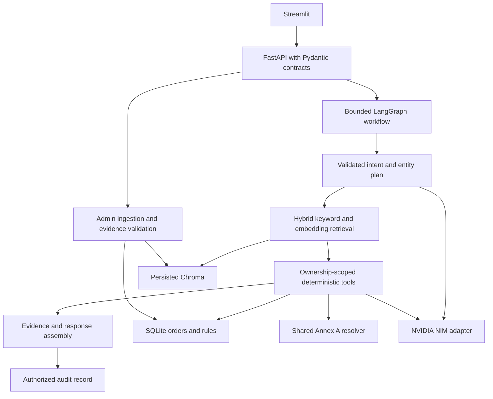

# Retail agent architecture

Four fixed workflow nodes perform planning, retrieval, deterministic execution, and assembly. The graph does not need multiple autonomous agents: authorization, policy precedence, dates, money, and idempotency are deterministic. The model proposes validated intent/entities and selects exact quotations; it cannot directly mutate data or set authoritative tool results.

Ingestion indexes a new generation before publishing it in one SQLite transaction. Retrieval filters Chroma against active source IDs and copies content from SQLite. This prevents orphaned vectors from becoming policy evidence. Duplicate IDs are rejected; explicit version IDs and supersedes metadata preserve history.

Runtime customer identity is supplied by the required request header. Every order read is scoped to that identity. The API protects admin ingestion and audit access separately. This trusted-header simulation needs gateway authentication for deployment outside the hackathon.

NIM API reference: https://docs.api.nvidia.com/nim/reference/nvidia-nemotron-3-super-120b-a12b-infer
